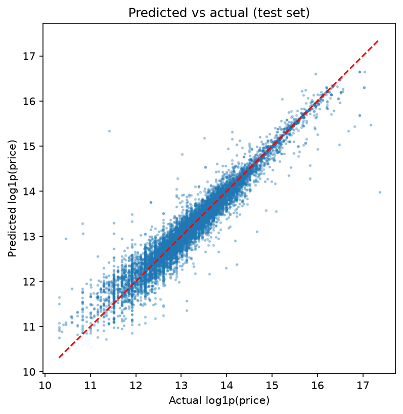
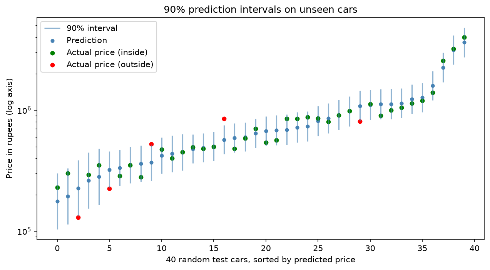
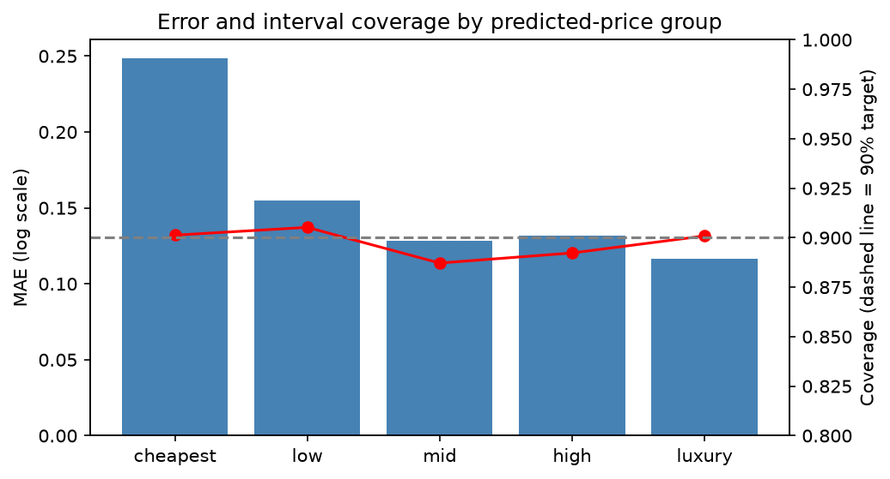
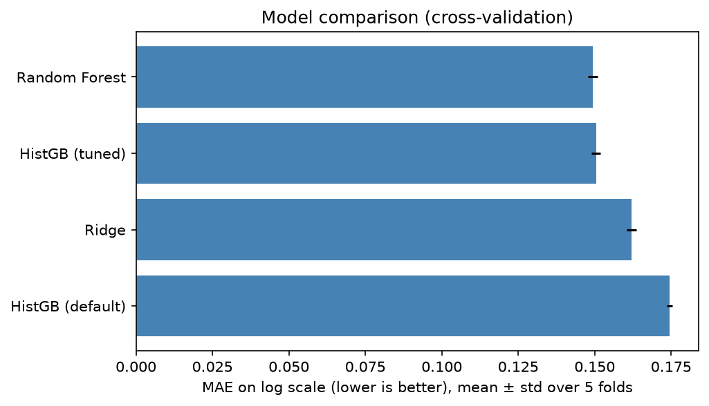

# BidWise: Used-Car Price Prediction with Prediction Intervals

Predicts Indian used-car prices and returns a 90% price range, not just one number.

## Results (held-out test set, 11,475 cars)
- Typical error: about 17% (test MAE 0.1572 on log price)
- Median error: Rs 52,206
- 90% prediction intervals covered 89.8% of unseen cars
- Coverage stayed between 88.7% and 90.5% in every price group

## Model comparison (5-fold CV on the training set, MAE on log price)
| Model | MAE |
|---|---|
| Ridge | 0.1621 ± 0.0016 |
| HistGB (tuned) | 0.1504 ± 0.0015 |
| Random Forest | 0.1493 ± 0.0016 |

Random Forest and tuned HistGB are tied. I chose Random Forest because it is simpler and a tuning grid showed no further gain.

## Method
1. Cleaning with fixed rules only (safe before the split)
2. Train/test split first; every learned step (imputing, scaling, encoding) is inside a scikit-learn Pipeline
3. Target is log1p(price), so errors are percentages
4. Split conformal prediction, calibrated separately for 5 predicted-price groups

## Data
Dataset: Shashi (2025), *Indian Used Car Listings Dataset (57,480 Records)*, Kaggle: <paste your Kaggle link>.
Put `indian_used_cars_raw_57480.csv` in `data/`. I used the raw file, because the numeric file encodes brand using average price, which leaks the target.

Issues I found and fixed: 28 missing fuel types, 77 impossible mileage values, duplicate brand spellings, a fake body type "15" (relabelled "Unknown"), and messy model names.

## Limitations
- Rare luxury brands (fewer than 10 listings, like Rolls-Royce) are predicted poorly
- Some listing prices look like data entry errors, which hurts accuracy for cheap cars
- Intervals are widest for the cheapest cars
- `city` added no accuracy and was dropped

## How to run
1. `pip install -r requirements.txt`
2. Run `02_clean.py`, `03_baseline.py`, `04_compare.py`, `05_intervals.py`, `06_final_test.py` in that order (`06` also creates `model.joblib`)

## API
Start the server: `python -m uvicorn app:app --reload`, then open http://127.0.0.1:8000/docs and try `POST /predict`.

Example request:
{"brand": "Maruti Suzuki", "model": "swift", "manufacturing_year": 2018, "km_driven": 60000, "fuel_type": "Petrol", "transmission_type": "Manual", "bodytype": "Hatchback", "number_of_owners": 1}

Example response (from my run):
{"price": 443948, "low": 314129, "high": 627417}